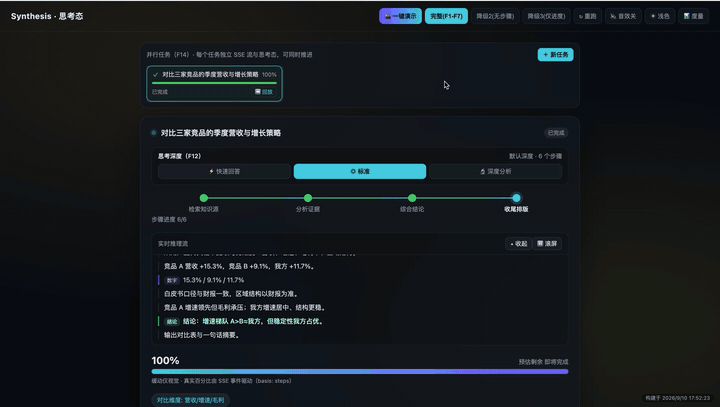

# Synthesis 思考态 · MVP Demo

<p align="center">
  
</p>

<p align="center">
  🎬 完整演示视频：<a href="https://www.bilibili.com/video/BV1n3nE6gEk3/">B 站 · Synthesis 思考态 17 步一键演示</a>
</p>

把 AI 长耗时「等待」重构为一段**有结构、可参与、可控制**的「思考态」体验的前端 MVP Demo：用户不再面对一个转圈，而是能看到 AI 在想什么、用了哪些材料，并随时介入或中断。React 18 + TypeScript + Vite 实现，SSE 事件流由 Vite dev server 本地 mock，无需后端。设计依据见 [prd.html 在线预览](https://wukun2005-gif.github.io/loadingUI/prd.html)，工程落地计划见 [dev-plan.md](./dev-plan.md)。

## 启动

```bash
npm install   # 首次
npm run dev
```

浏览器打开 http://localhost:5173 。

> 注意：SSE 事件流（`/api/thinking-stream`）只在 `npm run dev` 下由 Vite 插件 mock；`npm run preview` 是纯静态产物、没有事件流，会直接落入第 3 档兜底。

## 一键演示

点击右上角「🎬 一键演示」，自动跑完 17 步脚本（带模拟鼠标、自动滚动到演示目标、逐步解说卡片），约 110 秒覆盖全部能力：总览 → F1 时间线 → F2 推理流 → F7 知识源树（点开阅读全文 → 模拟「选择文件 → 读取 → 入树」上传全流程）→ F5 上下文 chips → F6 四级逃生舱 → F8 两档兜底降级 → F12 切深度档 → F13 画布节点点击 → F14 新增并行任务并来回切换 → F15 打开回放 → F16 音效开关 → 总结复位。也可用「跳过演示」逐步快进、「暂停演示」冻结。

## 能力一览

| 编号 | 能力 | 说明 |
|---|---|---|
| F1 | 多阶段进度时间线 | 检索 → 分析 → 综合 → 收尾四阶段，当前阶段 / 步骤进度实时可见 |
| F2 | 实时推理流 | 推理片段随 SSE 流式展开，数字 / 结论分样式，可暂停自动滚屏回看（不倒流重播） |
| F3 | 缓动进度条 | 「先慢后快」凸曲线缓动，仅做视觉平滑，真实百分比由 SSE 事件驱动；场景重置时瞬切、不倒退 |
| F4 | 环境氛围 | 随阶段变化的低干扰氛围层 |
| F5 | 上下文微信息 chips | SSE `context_chip` 事件实时推送「AI 此刻在关注什么」，无内容时不占位 |
| F6 | 四级逃生舱 | 推理开始即出现：①静音收起 ②后台运行（完成通知）③取消（二次确认）④紧急停止 |
| F7 | 知识源树（主干） | SVG 思维导图实时展示所用材料；点节点打开文档阅读器；支持上传文件 / 链接 / 文本与排除、启用、删除（标注「待采纳」，下一轮生效，不假装本轮已生效） |
| F8 | 三档兜底降级 | 完整 / 无步骤（推理流+进度）/ 仅进度（缓动+呼吸），空态绝不展示假步骤 |
| F9 | 推理详情折叠 | 推理流可收起 / 展开 |
| F10 | 参与式微交互 | 每次操作弹「已通知 AI · 下一轮生效」，头部累计「你已参与 N 次」 |
| F11 | 自适应明暗主题 | 深色 / 浅色切换并持久化 |
| F12 | 可调节思考深度 | 快速回答 / 标准 / 深度分析三档切换，深度档增加敏感性与风险权衡步骤（8 步）、预估时间随真实编排变长；切换即重连 SSE |
| F13 | 可视化推理画布 | 问题 → 四阶段 → 步骤 / 知识源 → 结论的 SVG 拓扑，节点随事件实时生长、活动连线流动，点任意节点查看对应推理片段；小屏横向滚动可用 |
| F14 | 多任务并行进度面板 | 可同时开多个 AI 任务，每个任务独立 SSE 流、阶段、进度与知识源；任务卡一键切换查看、互不打断，可关闭；完成后任务卡直接进回放 |
| F15 | 思考过程回放 | 任务完成后按原始事件间隔回放完整思考过程，支持暂停 / 从头 / 1×·2×·4× 快进 / 拖动进度条，并可导出**自包含 HTML 图文报告**（内联样式、无外部依赖，可直接分享） |
| F16 | 声音 / 触觉反馈 | 阶段切换与完成时的极弱 WebAudio 合成提示音（默认关、顶栏一键开关、偏好持久化）；触屏设备伴随轻微振动，桌面端不振动 |

顶栏还可手动切换 **完整(F1-F7) / 降级2(无步骤) / 降级3(仅进度)** 三种 SSE 场景，以及「📊 度量」埋点面板；任务面板可手动「＋ 新任务」体验并行。

## 常用命令

| 命令 | 说明 |
|---|---|
| `npm run dev` | 启动开发服务（含 SSE mock） |
| `npm run build` | 类型检查 + 生产构建到 `dist/` |
| `npm run preview` | 预览生产构建（纯静态，无 SSE mock） |
| `npx tsc --noEmit` | 严格类型检查 |

## 目录结构

```
src/
├─ App.tsx               # 多任务外壳 + 一键演示 runner（任务面板 / TaskView 装配 / 回放弹窗）
├─ components/           # 各功能组件
│  ├─ Timeline / ReasoningFlow / EasedProgress / ContextChips   # F1–F5
│  ├─ KnowledgeTree / EscapeHatch / FakeFileDialog / DocReader  # F6/F7
│  ├─ DepthSwitch.tsx          # F12 思考深度
│  ├─ ReasoningCanvas.tsx      # F13 推理画布
│  ├─ TaskPanel.tsx / TaskView.tsx   # F14 多任务
│  ├─ ReplayModal.tsx          # F15 过程回放
│  └─ MetricsPanel …
├─ demo/demoScript.ts    # 一键演示 17 步脚本（解说文案、模拟鼠标、自动操作）
├─ sse/                  # useThinkingTasks（N 路并行 SSE 消费）、useEasedProgress（缓动）
├─ state/                # model.ts（事件→视图模型纯归约）、useSources、exportReport（F15 导出）
├─ feedback/useFeedback.ts  # F16 WebAudio 音效 + 移动端振动
├─ mock/                 # 默认知识源等前端 mock
├─ analytics/            # 埋点（度量面板消费）
└─ styles.css
vite.config.ts           # Vite 配置 + SSE（mode/depth/q/speed）/ CRUD mock 插件
```

## 设计底线

- **忠实性**：缓动仅视觉，真实进度 / 步骤 / 推理内容全部来自 SSE 事件；无结构化内容时宁可降级留白，也不编造假步骤、假进度。
- **用户掌控**：等待期间随时可静音、转后台、取消或急停；用户补充的材料明确标注「下一轮采纳」，不伪装成本轮已生效。
